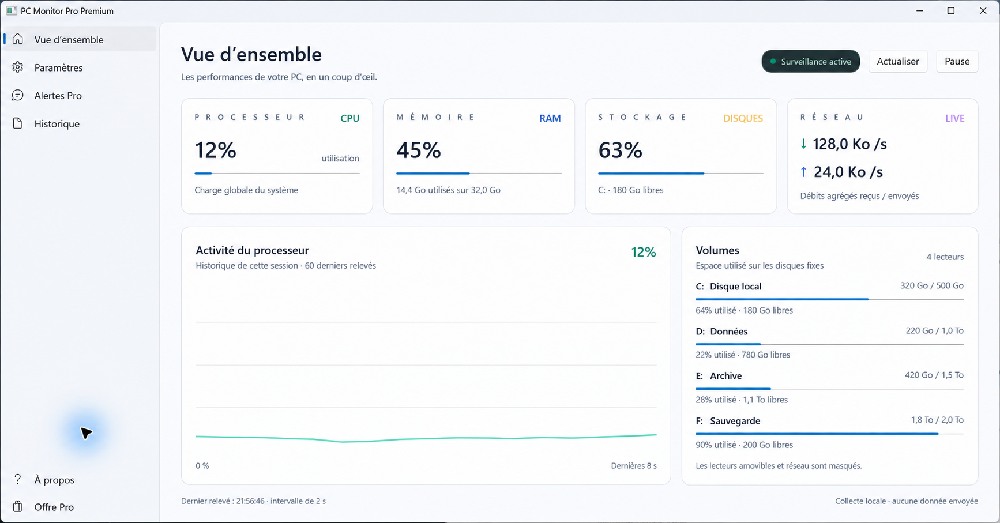

# PC Monitor Pro Premium

Application Windows de surveillance locale, conçue avec C#, WinUI 3 et .NET 10 pour Windows 10/11.

Le projet se trouve dans le dossier [`Windows/`](Windows/). Il affiche l’utilisation du processeur, de la mémoire, des disques et du réseau. Les mesures sont collectées localement, sans compte ni télémétrie distante.

*Illustration avec des valeurs de démonstration fictives.*

## État

- Version de travail : 0.2.2 ; l’EXE x64 est destiné aux essais.
- L’offre Microsoft Store est en brouillon. La soumission attend la publication de l’application parente et la mise à jour du profil fiscal/paiement du compte vendeur.
- Première préversion publique de l’EXE x64 : [PC Monitor Pro 0.2.0 — préversion d’essai](https://github.com/loictinant/PC-Monitor-Pro-Premium/releases/tag/v0.2.0) ([télécharger l’EXE](https://github.com/loictinant/PC-Monitor-Pro-Premium/releases/download/v0.2.0/PCMonitorPro.exe)). Elle est non signée et réservée aux essais.
- Le MSIX conserve une identité de développement et ne doit pas être distribué.
- Les instructions de compilation et les limites connues sont dans [`Windows/README.md`](Windows/README.md).

## Licence

Aucune licence de réutilisation du code n’est définie dans ce dépôt pour le moment.
